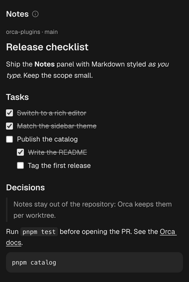

# Notes

[](https://github.com/eliasjnior/orca-worktree-notes/actions/workflows/ci.yml)



A notepad in Orca's right sidebar that styles Markdown as you type, like Notion or Jira, with
separate notes for each worktree.

- Markdown shortcuts turn into formatting as you type: `# ` to `### ` for headings, `- ` or `1. `
  for lists, `[] ` or `[x] ` for tasks, `> ` for quotes, ` ``` ` for code blocks, `---` for
  a rule, and `**bold**`, `*italic*`, `~~strike~~` and `` `code` `` inline.
- The usual shortcuts work too: Cmd+B, Cmd+I, Cmd+E for code, Cmd+Z to undo.
- The ⓘ beside the panel title lists these shortcuts on hover.
- Pasted URLs become links; Cmd+click (Ctrl+click elsewhere) opens one in the browser.
- Notes save as you type, with a small spinner in the header until they are written, and follow
  the focused worktree: each worktree keeps its own.

## Install

Needs Orca 1.4.246 or newer with plugins turned on (Settings → Plugins → **Turn on plugins**).

### From Orca's plugin directory (recommended)

Open [Notes in Orca's plugin directory](https://www.onorca.dev/plugins/eliasjnior/orca-worktree-notes) and
press **Open in Orca**. The page also shows the version on offer, what the plugin can access and
the install steps when Orca is not installed yet.

Orca then shows the plugin's page, where you press **Install**. The plugin comes from Orca's
community catalog, which Orca asks to add the first time. It runs a Node worker, so Orca also needs
**full-access plugins** allowed in Settings → Plugins, and shows what the plugin can access before
it starts.

Plugins installed this way update by themselves while **Update plugins automatically** is on
(Orca's default). Orca asks again only when a version needs more access than you approved.

### Or open it in Orca directly

[Open Notes in Orca](https://onorca.dev/plugins/eliasjnior.worktree-notes?catalog=community), or run on macOS
(`xdg-open` on Linux):

```sh
open "orca://plugins/eliasjnior.worktree-notes?catalog=community"
```

Both skip the directory page and open the same page in Orca.

### Or run it from a clone

```sh
git clone https://github.com/eliasjnior/orca-worktree-notes.git
orca plugin dev load orca-worktree-notes
```

The first run prints what the plugin can access and the same command with
`--approve <fingerprint>`; run that to turn it on. A development folder shows as
`Dev · unverified`, reloads when its files change and updates with `git pull`. It needs no build
step.

## Storage

Notes are stored as Markdown in the plugin's own storage (`storage.json` in Orca's plugin data),
keyed by the worktree's path. They are not written into the repository, so they never show up in
`git status`, and renaming a worktree keeps them. Moving or recreating a worktree at another path
starts it with empty notes.

## How it is built

- `panel/index.html` and `panel/main.ts`: an HTML panel running [Tiptap](https://tiptap.dev)
  (ProseMirror) with its Markdown extension. Its header, spacing and type match Orca's components
  panels (such as Scripts): colours come from Orca's `--orca-*` theme variables. Text uses the system
  UI font: frames load only the plugin's own files, and Orca's plugin directory rejects bundled
  fonts as binary files. The background uses `--orca-card`: Orca paints its app background behind HTML panels and
  does not pass them `--sidebar`, and `--card` is the sidebar colour in the default themes (within
  a shade or two in others, such as Ayu).
- `panel/notes.ts`: loading and debounced saving per worktree, with no DOM, so it is unit-tested.
- `src/worker.ts`: panels only learn the focused worktree's name and branch; the worker matches
  that against Orca's workspace list to get its path. The panel remembers each answer, so later
  opens load the notes straight from storage while the worker (which may have to start) confirms
  the path in the background.
- `vendor/tiptap.mjs`: Tiptap bundled into one file by `pnpm vendor` (frames load no npm packages).

## Access

- Runs a Node worker, only to look up the focused worktree's path.
- `workspace:read`: know which worktree is focused.
- `storage:own`: keep the notes.

## Limits

Orca's plugin storage limits apply: 256 KiB of Markdown per worktree and 5 MiB for all worktrees
together. A save over the limit shows an alert icon in the panel header (hover it for the reason) and
keeps the text in the editor.

## Development

Needs Node 24, pnpm and the Orca desktop app (its `orca` CLI on `PATH`). The plugin loads as
written (TypeScript, no build step); the only generated file is Tiptap bundled into `vendor/tiptap.mjs`, built by
`pnpm vendor`.

```sh
pnpm install
pnpm types   # writes Orca's typings into .orca/types (git-ignored)
```

`pnpm types` runs `orca plugin types` and, if that fails (Orca 1.4.247 ships without the typings
file it reads), downloads the same typings from the Orca repository at the installed version's tag.
Opening this repository as an Orca worktree runs both steps through `orca.yaml`.

```sh
orca plugin dev watch . --check                     # load, reload on save, stream logs
orca plugin open local.worktree-notes --panel notes   # show it in the right sidebar
```

| Command          | Runs                                                              |
| ---------------- | ----------------------------------------------------------------- |
| `pnpm typecheck` | `tsc` (Orca transpiles without type-checking)                     |
| `pnpm test`      | `orca plugin test .`                                              |
| `pnpm check`     | `orca plugin check .`: validates the plugin and renders its panel |
| `pnpm validate`  | `orca plugin validate .`                                          |
| `pnpm lint`      | Biome; `pnpm format` applies its fixes                            |
| `pnpm binaries`  | Fails on tracked binary files, which Orca's directory refuses     |
| `pnpm vendor`    | Rebuilds the `vendor/*.mjs` bundle after upgrading Tiptap         |

CI runs Biome, the binary check, the typecheck and a check that `vendor/` matches the lockfile on
every pull request. `pnpm test` and `pnpm check` need the Orca app, so run them before opening the
pull request.

## Releasing

The repository root is the plugin, so Orca installs every tracked file in it. Orca's plugin
directory lists the newest `vX.Y.Z` tag, pinned to its commit and file hash, and a listed version
never changes. `main` only takes pull requests, squash-merged.

1. Raise `version` in `orca-plugin.json`, open a pull request and merge it.
2. Tag the merged `main` commit with that version and push the tag:

   ```sh
   git switch main && git pull
   git tag -a v1.2.0 -m v1.2.0 && git push origin v1.2.0
   ```

The directory checks tags about every 30 minutes. A new version can wait for a maintainer's review
before it is listed; [the plugin's status page](https://onorca.dev/plugins/eliasjnior/orca-worktree-notes)
says whether it is listed or what to fix. Release tags cannot be moved or deleted.

The directory refuses a tag that holds any binary file except PNG, JPEG, WEBP and GIF images
(fonts included), which `orca plugin validate` does not catch and `pnpm binaries` does.

### Screenshots and catalog art

`docs/screenshot.png` is the panel as Orca draws it, for this README. Retake it after a visible
change, with content in English, and crop the empty space under the content:

```sh
orca plugin shot local.worktree-notes --panel notes --width 380 --out docs/screenshot.png
```

The directory shows `assets/icon.png` (256×256), `assets/cover.png` (1600×1000) and
`assets/screenshot-1.png` (1280×800), listed in `orca-plugin.json`. They are drawn from
`art/icon.html`, `art/cover.html` and `art/screenshot.html`, which embed `docs/screenshot.png` and
load Geist from `node_modules` (run `pnpm install` first): open one in a browser at that size and
save it as PNG. Orca accepts PNG or WEBP icons up to 256 KB, covers up to 1 MB and screenshots up
to 1.5 MB.

Cards show the whole 16:10 cover, but the plugin's page caps it at 256 px tall and crops the
middle, which on a wide window leaves only about y 380 to 620 of the 1000 px. Keep the name,
tagline and anything else that must be read inside that band.

## History

This plugin was developed in [eliasjnior/orca-plugins](https://github.com/eliasjnior/orca-plugins)
up to version 1.1.2; this repository keeps its history, and pull request numbers in older commit
messages refer to that repository.

## License

[MIT](LICENSE). The bundled [Tiptap](https://tiptap.dev) (MIT) build keeps its notices in `vendor/`.

Security issues: see [SECURITY.md](SECURITY.md).
